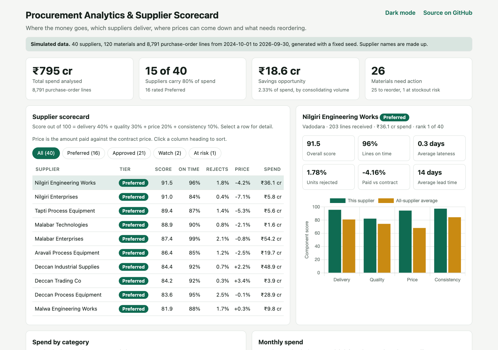
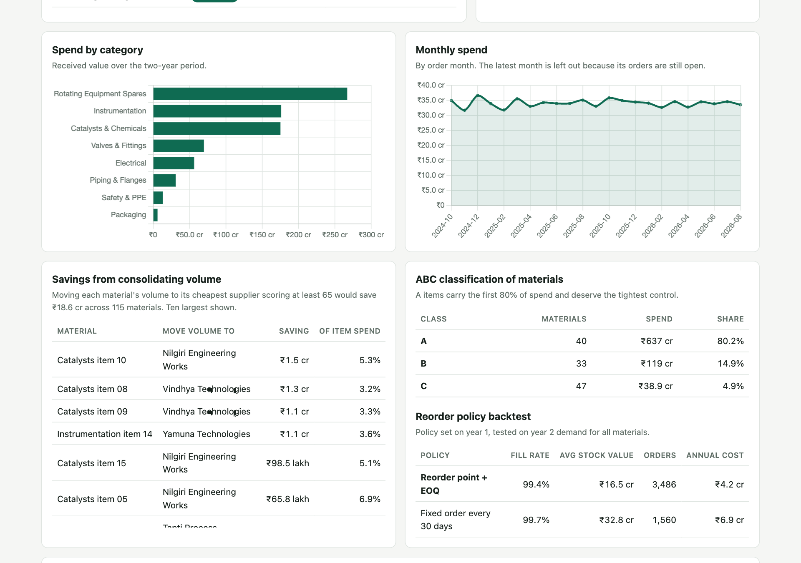
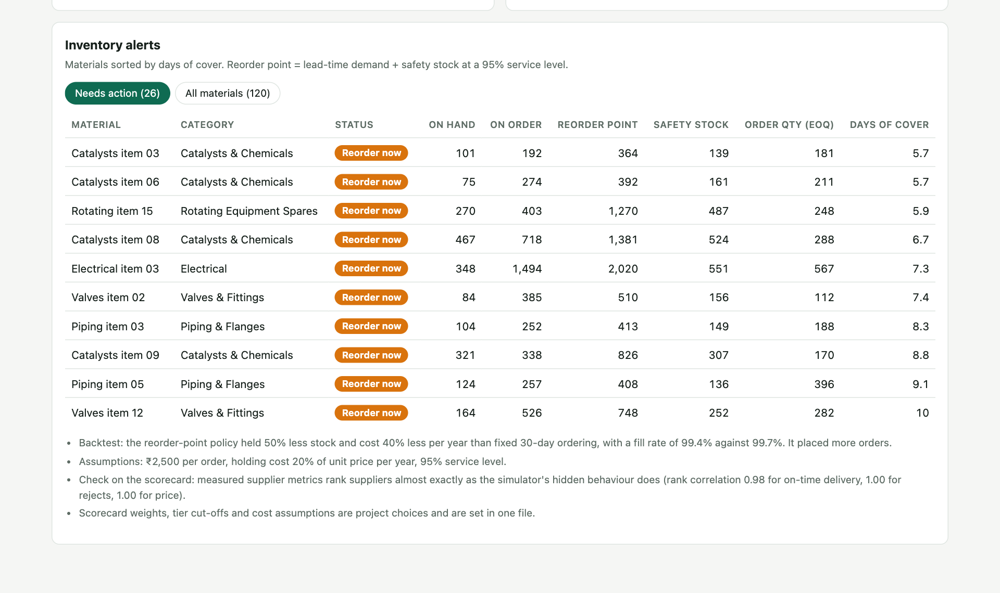

# Procurement Analytics & Supplier Scorecard


Answers four questions a procurement team asks every month: **where does the money go, which suppliers deliver, where can prices come down, and what needs reordering?**

**Live demo:** https://khushal-narsaria.github.io/Procurement-Analytics-Supplier-Scorecard/



> **The demo data are simulated.** No public data set carries supplier delivery, quality and price history together, so a seeded simulator generates two years of purchasing for a process plant. Supplier names are made up. Every figure below describes that simulated data and is reproducible with `python run.py`.

## What it does

| Module | Output |
| --- | --- |
| **Spend analysis** | Spend by category, supplier and month; Pareto concentration; ABC classification of materials |
| **Supplier scorecard** | On-time delivery, lateness, reject rate and price against contract, combined into a 0–100 score and four tiers |
| **Savings analysis** | Saving from moving each material's volume to its cheapest *qualified* supplier |
| **Inventory policy** | Safety stock, reorder point and economic order quantity per material, with reorder and stockout alerts |
| **Policy backtest** | Reorder-point policy against fixed-calendar ordering on a year of unseen demand |

## Results on the simulated data

The data set has 40 suppliers, 120 materials in 8 categories, 8,791 purchase-order lines and 87,600 daily demand rows, covering 1 October 2024 to 30 September 2026.

- **Spend concentration.** 15 of 40 suppliers carry 80% of the ₹795 crore spend. 40 of 120 materials are class A (80% of spend).
- **Scorecard.** 16 suppliers rate Preferred, 21 Approved, 2 Watch and 1 At risk.
- **Savings.** Consolidating volume with the cheapest supplier scoring at least 65 would save ₹18.6 crore, or 2.3% of spend, across 115 materials.
- **Inventory.** 25 materials are at or below their reorder point and 1 is at stockout risk.
- **Backtest.** With the policy set on year 1 and tested on year 2, the reorder-point policy held 50% less stock (₹16.5 crore against ₹32.8 crore) and cost 40% less per year in ordering and holding (₹4.2 crore against ₹6.9 crore) than ordering a fixed quantity every 30 days. Fill rate was 99.4% against 99.7%, and it placed 3,486 orders against 1,560.



### Does the scorecard measure the right thing?

Each simulated supplier has hidden "true" behaviour: an on-time probability, a defect rate and a price level. The analytics never see those values. A test compares the measured metrics with them:

| Measured metric | Hidden value | Spearman rank correlation |
| --- | --- | ---: |
| On-time rate | On-time probability | 0.98 |
| Reject rate | Defect rate | 1.00 |
| Price against contract | Price level | 1.00 |

So with about 210 received lines per supplier, the scorecard ranks suppliers almost exactly as their real behaviour would.



## How it works

```
simulator ──► SQLite (supplier, material, po_line, demand) ──► SQL metrics ──► Python scoring and policy ──► data.json ──► dashboard
```

**Supplier metrics are computed in SQL** ([`sql/supplier_metrics.sql`](sql/supplier_metrics.sql)) from received purchase-order lines. Scoring is in [`src/procure/analytics.py`](src/procure/analytics.py):

| Component | Weight | Scale |
| --- | ---: | --- |
| Delivery | 40% | Share of lines received on or before the promised date |
| Quality | 30% | 100 at no rejects, 0 at a 10% reject rate |
| Price | 20% | 100 at 5% under contract, 0 at 10% over |
| Consistency | 10% | 100 at no lateness, 0 at an average of 10 days late |

Tiers: Preferred ≥ 80, Approved ≥ 65, Watch ≥ 50, At risk below 50.

**Inventory policy** per material, at a 95% service level (z = 1.645):

```
safety stock  = z × √(L × σd² + d² × σL²)        d, σd = mean and std of daily demand
reorder point = d × L + safety stock              L, σL = mean and std of lead time in days
EOQ           = √(2 × annual demand × order cost / (holding rate × unit price))
```

## Run it

```bash
python -m venv .venv && source .venv/bin/activate
pip install -r requirements.txt
python run.py                      # builds data/procurement.db, runs the analysis, writes docs/data.json
pytest -q                          # 9 tests
python -m http.server -d docs 8000 # dashboard at http://localhost:8000
```

## Tests

The 9 tests cover: deterministic generation, referential and range integrity, the SQL metrics against a hand calculation, recovery of the hidden supplier behaviour, score scales and tiers, ABC and Pareto, the savings rule (volume only moves to qualified suppliers), the inventory formulas, and the stock simulation.

## Repository layout

```
sql/             schema and analysis queries
src/procure/     generate.py (simulator) · analytics.py (scorecard, ABC, savings, inventory, backtest)
run.py           build → analyse → export
tests/           9 tests
docs/            static dashboard (GitHub Pages) and data.json
```

## Limitations

- The data are simulated. The results show that the method works on data with known behaviour, not what a real plant would save.
- Scorecard weights, tier cut-offs, order cost (₹2,500), holding rate (20% a year) and service level (95%) are assumptions, set in one file.
- The savings figure ignores supplier capacity, contract terms and switching cost.
- The backtest treats unmet demand as lost and compares against one simple baseline.
- Demand is modelled as stationary with a weekly pattern; there is no trend or seasonality forecast.
